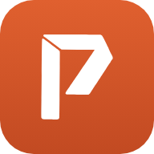
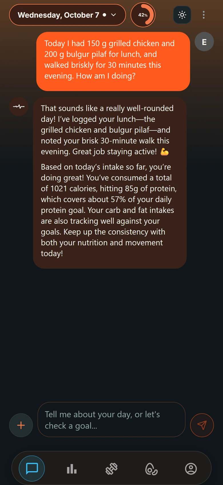
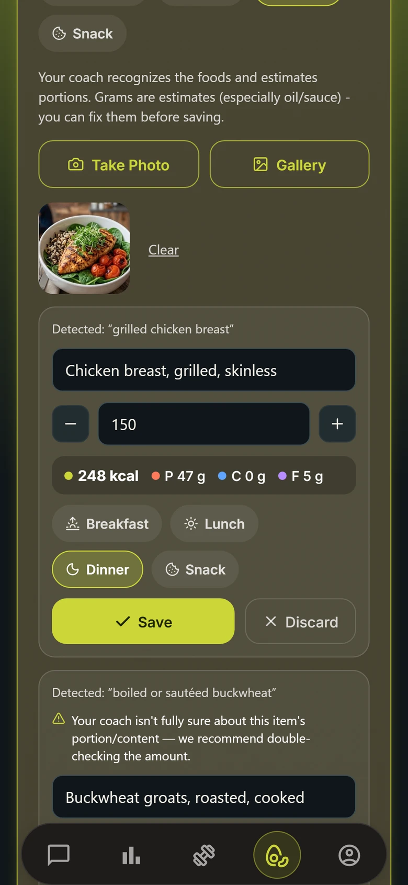
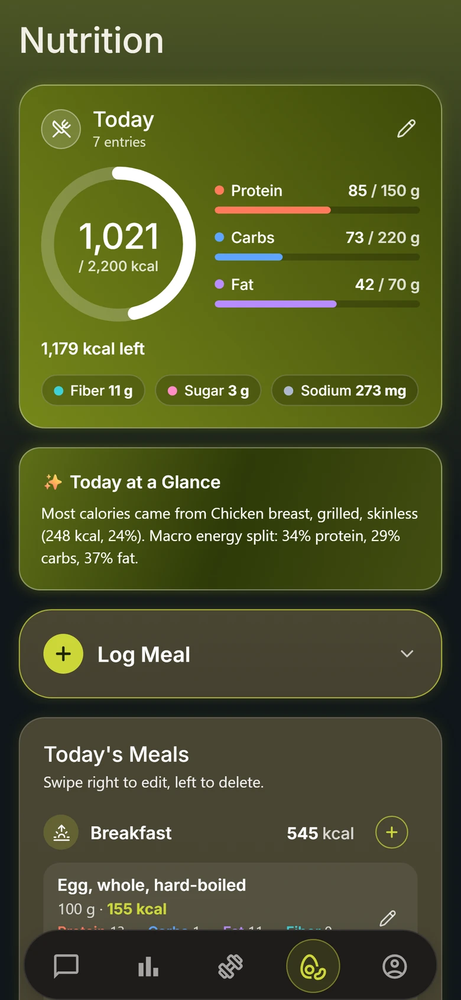
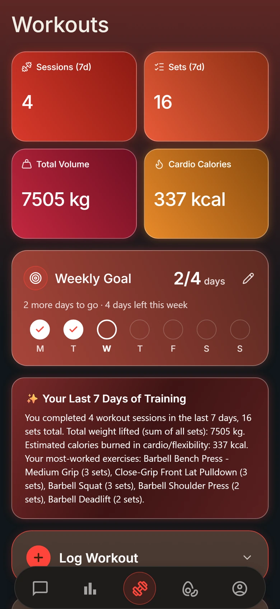
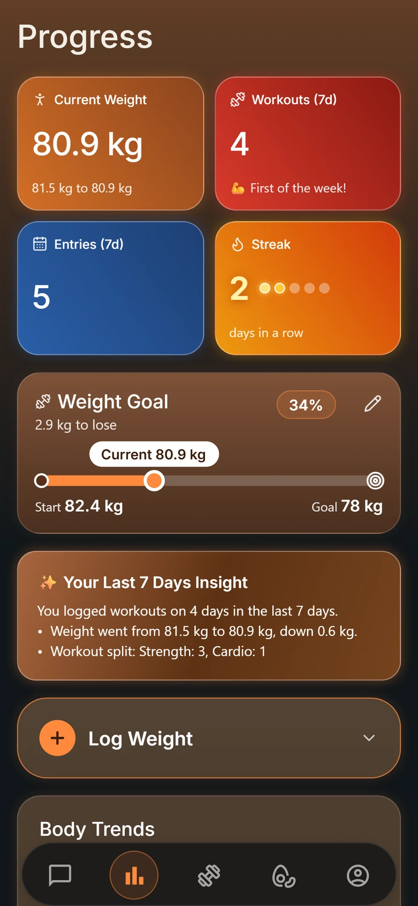
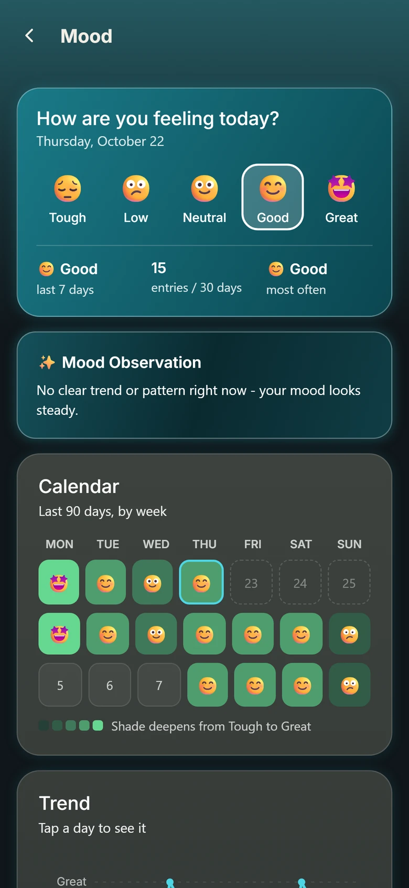
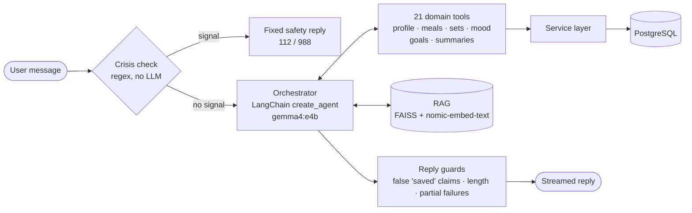
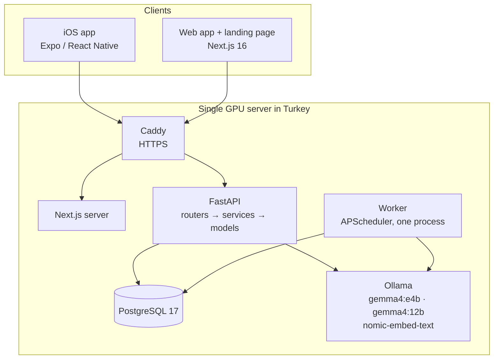

<p align="center">
  
</p>

<h1 align="center">PulseCoach</h1>

<p align="center">
  <strong>An AI health and fitness coach you can talk to.</strong><br>
  Log meals, workouts and mood by chatting, get calories from a photo of your plate,<br>
  and follow your progress. The AI runs on our own GPU server, so your health data never goes to a third-party AI service.
</p>

<p align="center">
  <a href="https://pulsecoachapp.com/?lang=en">Website</a> ·
  iOS app (App Store, in review) ·
  <a href="README.tr.md">Türkçe</a> ·
  <a href="docs/ARCHITECTURE.md">Architecture</a> ·
  <a href="docs/AI.md">AI design</a>
</p>

<p align="center">
  
  
  
  
  
  
  
  
</p>

<table>
  <tr>
    <td></td>
    <td></td>
    <td></td>
    <td></td>
    <td></td>
    <td></td>
  </tr>
  <tr align="center">
    <td>Chat</td><td>Meal photo</td><td>Nutrition</td><td>Workouts</td><td>Progress</td><td>Mood</td>
  </tr>
</table>

---

## What it does

Most trackers make you fill in forms. In PulseCoach you write what you did in your own words:

> *"I had 150 g grilled chicken and bulgur pilaf for lunch and walked briskly for 30 minutes this evening."*

The coach finds both foods in a 7,900-item catalog, logs the meal with calories and macros, logs the walk with an
estimated calorie burn, and replies with how your day is going against your goals. Everything it saves can also be
seen and edited on the regular screens.

| Area | Features |
|---|---|
| **AI coach** | Logs meals, sets, cardio, weight and mood from free text (also for past days: *"yesterday I swam 40 min"*). Answers nutrition and training questions from a curated knowledge base (RAG). Adapts its tone (warm / energetic / neutral) and reply length. Streams the reply and shows what it is doing (*"Checking nutrition knowledge"*). |
| **Meal photo** | Recognizes the foods on a plate and estimates portions. Calories always come from the catalog, never from the model, and nothing is saved until you confirm. |
| **Nutrition** | 7,900+ foods (USDA FoodData Central plus hand-researched Turkish dishes), daily summary per meal, 7/14/30-day calorie trends, fiber, sugar and sodium. A personal calorie target (Mifflin-St Jeor) that stays consistent with your protein, carb and fat goals. |
| **Workouts** | 890+ exercises (strength and cardio), best set and personal records per exercise, progress charts, volume, cardio calories from MET values, a weekly "days trained" goal. |
| **Progress** | Weight, waist and body fat goals, weekly insights, monthly trends, streaks, nine badges and a Goal Center that brings every goal together. |
| **Mood** | One-tap daily mood, a mood calendar and short insights on how mood relates to training. A deterministic crisis safety layer runs before the model ever sees a message. |
| **Check-ins** | A weekly review from the coach every Sunday, and a reminder at most every three days, only when you have not opened the app. Reminders are scheduled on the device, so no push token is ever sent to a server. |
| **Everywhere** | iOS app and web app with the same account, Turkish and English (UI and coach replies), light and dark themes, Face ID app lock. |

## How the AI coach works



- **One orchestrator, many tools.** A single ReAct agent (`langchain.agents.create_agent`) gets 21 tools grouped
  into domain "agents" (profile, nutrition knowledge, exercise knowledge, workout logging, meal logging, progress,
  motivation, mood support). The tools call the same service layer as the REST API and the scheduler, so there is
  one place for business rules.
- **The model does not get the last word on facts.** Calories come from the catalog. Exercise names are matched by
  code: the model only names the movement in English, then a lexical and embedding search picks the catalog row.
  Every number the model passes in is clamped and validated.
- **Guards after the model.** A small LLM can say *"I saved it"* without calling a tool. The orchestrator checks which
  write tools actually succeeded. If the reply claims a save that did not happen, it retries once and otherwise tells
  the user honestly that nothing was saved.
- **Measured, not guessed.** `backend/eval/` runs real-model evaluations: a 47-scenario chat logging regression
  suite (what was written to the database, not just what the reply says), a model comparison (gemma4:e4b vs
  qwen3:14b, 248 calls), reply-length and latency benchmarks.

More in [docs/AI.md](docs/AI.md).

## Architecture



| Layer | Stack |
|---|---|
| Backend | Python 3.13, FastAPI, SQLAlchemy 2, Alembic (18 migrations), Pydantic, APScheduler |
| AI | LangChain `create_agent`, Ollama: `gemma4:e4b` (chat, reasoning on), `gemma4:12b` (meal photo vision), `nomic-embed-text` (RAG and catalog search), FAISS |
| Data | PostgreSQL in production, SQLite for local development; the full test suite runs on both |
| Web | Next.js 16 (App Router), React 19, TypeScript, Tailwind CSS v4, custom SVG charts |
| Mobile | Expo SDK 54, React Native 0.81, Expo Router, Reanimated 4, SecureStore, local notifications |
| Auth | Email + password (bcrypt), Sign in with Google and Apple, short-lived JWT + rotating refresh tokens |
| Ops | systemd services, Caddy with Let's Encrypt, nightly encrypted off-site backups, health and readiness checks |
| CI | GitHub Actions: pytest on SQLite and Postgres, ruff, pyright (0 errors), API contract check, web lint and build, mobile type check and lint, a full deploy smoke test on a fresh Ubuntu VM |

Read [docs/ARCHITECTURE.md](docs/ARCHITECTURE.md) for the request flow, data model, streaming and scheduler design.

## Privacy by design

Health data is the most sensitive data an app can hold, so the architecture starts from that:

- **No third-party AI.** The language and vision models run on our own server with Ollama. Messages and meal photos
  are not sent to OpenAI, Google or any other AI provider, and are never used to train models.
- **Data stays in Turkey.** The database, models and backups live on servers in Turkey. Cloudflare is used only for DNS.
- **No ads, no analytics SDKs, no server push.** Reminders are scheduled on the device and their text never contains health data.
- **User control.** Download everything as JSON or delete the account permanently from the app.
- **Compliance.** KVKK (Turkey's data protection law), plus a U.S. Consumer Health Data Privacy Policy for
  Washington's My Health My Data Act and similar state laws.
- **Not a medical device.** The coach does not diagnose or prescribe. Crisis language triggers a fixed safety reply
  instead of model output.

Details: [docs/PRIVACY.md](docs/PRIVACY.md).

## Repository layout

```
backend/          FastAPI app, agents, RAG, scheduler, tests, evals, catalog scripts
  app/agents/     orchestrator, tools per domain, prompts, crisis layer
  app/services/   business logic shared by API, agent tools and scheduler
  app/rag/        knowledge base embedding and retrieval
  eval/           real-model evaluations and benchmarks
  knowledge_base/ curated nutrition and exercise articles used by RAG
web/              Next.js web app and landing page (+ Playwright e2e)
mobile/           Expo iOS app (+ App Store listing and screenshot tooling)
deploy/           production setup script, systemd units, Caddy config
tools/            legal text generator (KVKK, Terms, U.S. health data policy)
docs/             project documentation
```

## Quick start

You need Python 3.13, Node.js 22 and [Ollama](https://ollama.com).

```bash
# 1. Models
ollama pull gemma4:e4b && ollama pull gemma4:12b && ollama pull nomic-embed-text

# 2. Backend (from the repo root)
python -m venv venv && venv/Scripts/activate          # Linux/macOS: source venv/bin/activate
pip install -r backend/requirements.txt
echo "JWT_SECRET_KEY=$(python -c 'import secrets; print(secrets.token_urlsafe(64))')" > .env
cd backend && uvicorn app.main:app --reload            # http://localhost:8000/docs

# 3. Web (new terminal)
cd web && npm install && npm run dev                   # http://localhost:3000
```

The food and exercise catalogs are not stored in git. See
[docs/DEVELOPMENT.md](docs/DEVELOPMENT.md#catalogs) for loading them, running the mobile app, tests and evaluations.

## Documentation

| Document | Contents |
|---|---|
| [ARCHITECTURE.md](docs/ARCHITECTURE.md) | Layers, request flow, data model, chat streaming, scheduler, auth, clients |
| [AI.md](docs/AI.md) | Agent and tool design, guards, RAG, catalog matching, meal photo pipeline, model choices, evaluations |
| [ENGINEERING-NOTES.md](docs/ENGINEERING-NOTES.md) | The hardest bugs and the decisions behind the design |
| [PRIVACY.md](docs/PRIVACY.md) | How the system protects health data; KVKK and U.S. compliance |
| [DEVELOPMENT.md](docs/DEVELOPMENT.md) | Local setup, catalogs, mobile, tests, evals, CI |
| [DEPLOYMENT.md](docs/DEPLOYMENT.md) | Production topology, release flow, backups, monitoring |
| [Model comparison report](backend/eval/results/model_comparison.md) | gemma4:e4b vs qwen3:14b, with charts (Turkish) |

## Status

PulseCoach went live on 19 October 2026: the web app runs at [pulsecoachapp.com](https://pulsecoachapp.com/?lang=en)
and version 1.0 of the iOS app has been submitted to the App Store (Turkey and the United States). It is free with no
in-app purchases. A daily message limit keeps the shared GPU fair for everyone.

## Disclaimer

PulseCoach provides general wellness information. It is not a medical device and is not a substitute for advice from a
doctor, dietitian or mental health professional.

## License

[MIT](LICENSE) © 2026 Bora Eren Erdem. Data sources keep their own terms: USDA FoodData Central (public domain),
[free-exercise-db](https://github.com/yuhonas/free-exercise-db) (Unlicense), landing page photos from Unsplash.
