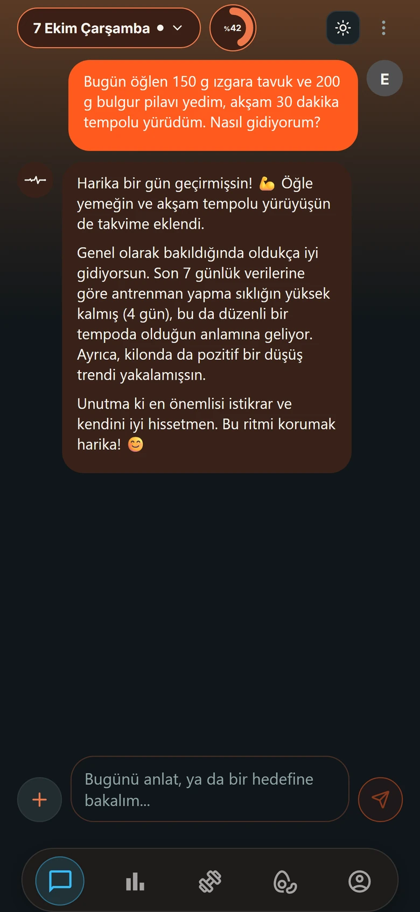
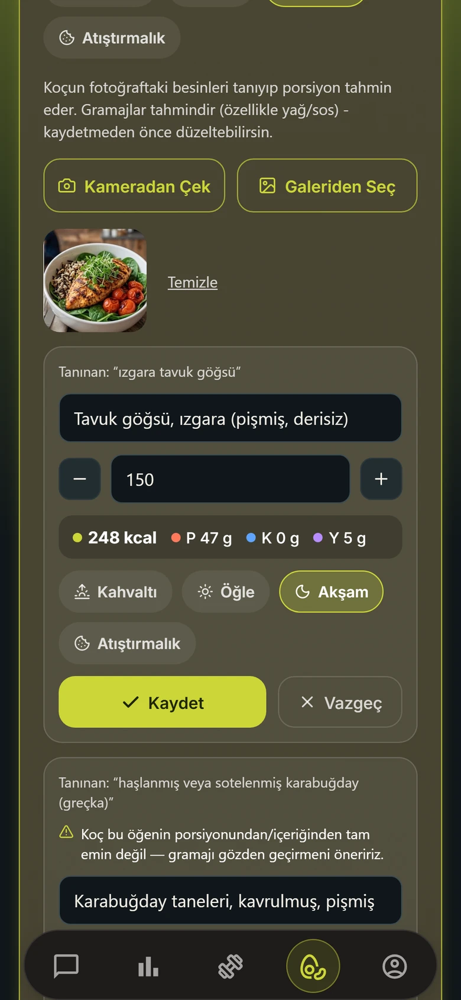
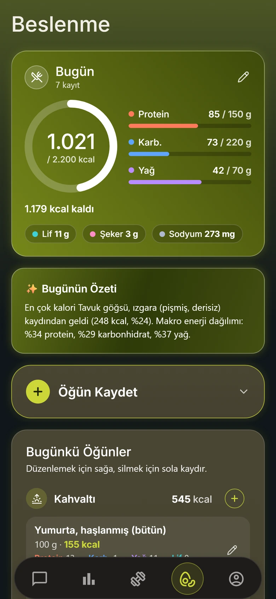
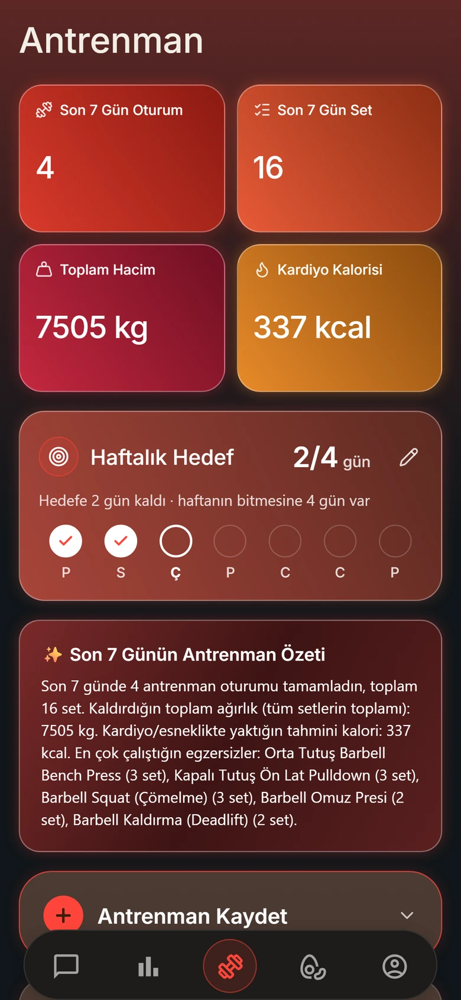
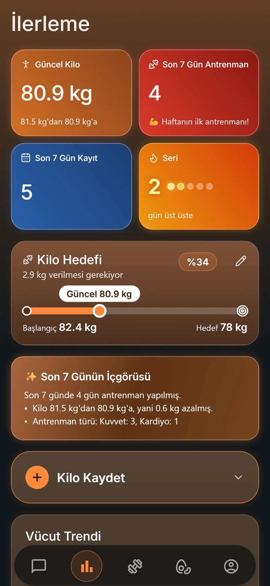
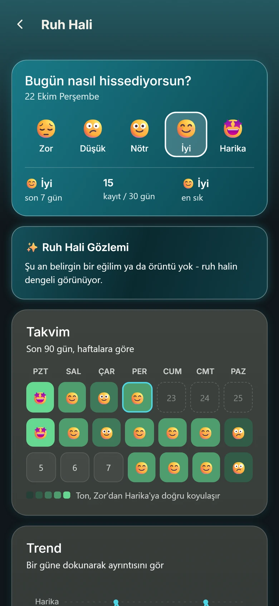
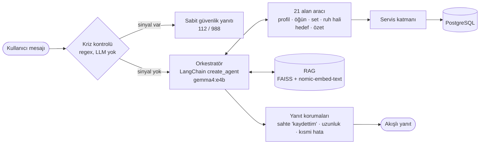
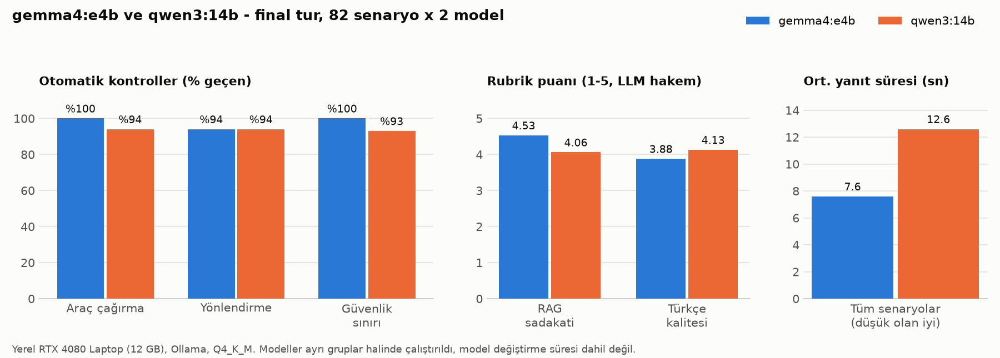
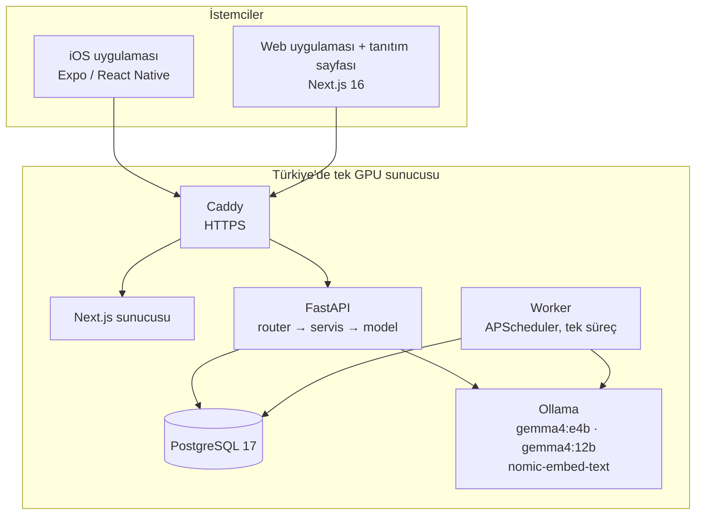

<p align="center">
  
</p>

<h1 align="center">PulseCoach</h1>

<p align="center">
  <strong>Konuşarak kullanılan yapay zeka destekli sağlık ve fitness koçu.</strong><br>
  Öğününü, antrenmanını ve ruh halini sohbetle kaydet, tabağının fotoğrafından kaloriyi öğren,<br>
  ilerlemeni takip et. Yapay zeka kendi GPU sunucumuzda çalışır, sağlık verilerin üçüncü taraf yapay zeka hizmetlerine gitmez.
</p>

<p align="center">
  <a href="https://pulsecoachapp.com">Web sitesi</a> ·
  iOS uygulaması (App Store, incelemede) ·
  <a href="README.md">English</a> ·
  <a href="docs/ARCHITECTURE.md">Mimari</a> ·
  <a href="docs/AI.md">Yapay zeka tasarımı</a>
</p>

<p align="center">
  
  
  
  
  
  
  
  
</p>

<table>
  <tr>
    <td></td>
    <td></td>
    <td></td>
    <td></td>
    <td></td>
    <td></td>
  </tr>
  <tr align="center">
    <td>Sohbet</td><td>Fotoğraf</td><td>Beslenme</td><td>Antrenman</td><td>İlerleme</td><td>Ruh hali</td>
  </tr>
</table>

> Ayrıntılı teknik belgeler (`docs/`) İngilizcedir. Bu sayfa projenin Türkçe özetidir.

---

## Ne yapar?

Çoğu takip uygulaması form doldurtur. PulseCoach'ta ne yaptığını kendi cümlelerinle yazarsın:

> *"Öğlen 150 g ızgara tavuk ve bulgur pilavı yedim, akşam 30 dakika tempolu yürüdüm."*

Koç iki besini 7.900 kayıtlık katalogda bulur. Öğünü kalori ve makrolarıyla, yürüyüşü de tahmini harcanan kaloriyle
kaydeder. Ardından günün hedeflerine göre nasıl gittiğini söyler. Kaydettiği her şey normal ekranlarda da görünür ve
düzenlenebilir.

| Alan | Özellikler |
|---|---|
| **Yapay zeka koçu** | Serbest metinden öğün, set, kardiyo, kilo ve ruh hali kaydı (geçmiş günler için de: *"dün 40 dk yüzdüm"*). Beslenme ve antrenman sorularını seçilmiş bir bilgi tabanından (RAG) yanıtlar. Tonu (samimi / enerjik / nötr) ve yanıt uzunluğu ayarlanır. Yanıt akarak gelir, araç çalışırken ne yaptığını gösterir (*"Beslenme bilgilerine bakıyorum"*). Tek tek mesajlar kopyalanabilir ya da silinebilir, sohbet ekranında her gün bir ipucu çıkar. |
| **Fotoğrafla öğün** | Tabaktaki besinleri tanır ve porsiyonu tahmin eder. Kalori her zaman katalogdan gelir, modelden gelmez. Sen onaylamadan hiçbir şey kaydedilmez. |
| **Beslenme** | 7.900'den fazla besin (USDA FoodData Central ve elle araştırılmış Türk mutfağı), öğün öğün günlük özet, 7/14/30 günlük kalori eğilimi, lif, şeker, sodyum. Kişisel kalori hedefi (Mifflin-St Jeor) protein, karbonhidrat ve yağ hedefleriyle her zaman tutarlı kalır. |
| **Antrenman** | 890'dan fazla egzersiz (kuvvet ve kardiyo), her hareket için en iyi set ve kişisel rekorlar, ilerleme grafikleri, hacim, MET değerleriyle kardiyo kalorisi, haftalık "kaç gün antrenman" hedefi. |
| **İlerleme** | Kilo, bel ve yağ oranı hedefleri, haftalık içgörüler, aylık eğilimler, seriler, dokuz rozet ve bütün hedefleri bir araya getiren Hedef Merkezi. |
| **Ruh hali** | Tek dokunuşla günlük ruh hali, ruh hali takvimi ve antrenmanla ilişkisine dair kısa içgörüler. Mesaj modele ulaşmadan önce kural tabanlı bir kriz güvenlik katmanından geçer. |
| **Koç mesajları** | Her pazar koçtan haftalık değerlendirme. Uygulamayı açmadığın günlerde en fazla üç günde bir hatırlatma. Hatırlatmalar cihazda zamanlanır, sunucuya bildirim jetonu gitmez. |
| **Her yerde** | Aynı hesapla iOS uygulaması ve web uygulaması, Türkçe ve İngilizce (arayüz ve koç yanıtları), açık ve koyu tema, Face ID ile uygulama kilidi. |

## Yapay zeka koçu nasıl çalışır?



- **Tek orkestratör, çok araç.** Tek bir ReAct ajanı (`langchain.agents.create_agent`) alanlara göre gruplanmış 21
  araç kullanır: profil, beslenme bilgisi, egzersiz bilgisi, antrenman kaydı, öğün kaydı, ilerleme, motivasyon, ruh
  hali desteği. Araçlar REST API ve zamanlayıcıyla aynı servis katmanını çağırır, iş kuralları tek bir yerdedir.
- **Gerçeklerde son söz modelin değil.** Kalori katalogdan hesaplanır. Egzersiz adını kod eşleştirir: model yalnızca
  hareketin standart İngilizce adını söyler, katalog satırını kelime ve anlam (gömme) araması seçer. Modelin verdiği
  her sayı sınırlanır ve doğrulanır.
- **Modelden sonra korumalar.** Küçük bir model hiçbir araç çağırmadan *"kaydettim"* diyebilir. Orkestratör hangi
  yazma araçlarının gerçekten başarılı olduğuna bakar. Yanıt, olmamış bir kaydı iddia ediyorsa bir kez yeniden dener.
  Yine olmazsa kullanıcıya hiçbir şeyin kaydedilmediğini dürüstçe söyler.
- **Tahmin değil ölçüm.** `backend/eval/` gerçek modelle değerlendirme yapar: 47 senaryoluk sohbet kayıt regresyonu
  (yanıtın ne dediğine değil, veritabanına ne yazıldığına bakar), model karşılaştırması (gemma4:e4b ve qwen3:14b,
  248 çağrı), yanıt uzunluğu ve gecikme ölçümleri.

Ayrıntılar: [docs/AI.md](docs/AI.md).

## Model nasıl seçildi?

<p align="center"></p>

Sohbet modeli iki turluk bir karşılaştırmayla seçildi: 124 etiketli senaryo, 248 model çağrısı. Araç çağırma,
yönlendirme ve güvenlik otomatik olarak geçti/kaldı diye ölçüldü, kaynağa sadakat ve Türkçe kalitesi ise bir LLM
hakemin rubrikle verdiği puanlarla. `gemma4:e4b`; bilgi tabanına sadakatte (hiç bilgi uydurmadı, `qwen3:14b` iki kez
uydurdu), araç çağırmada ve hızda (7,6 sn ve 12,6 sn) öne geçti. `qwen3:14b` biraz daha iyi Türkçe yazdı. İlk ve daha
küçük tur ters yönü gösteriyordu, ikinci tur kararı değiştirdi. Aynı yöntemle fotoğraf modeli seçildi, düşünme
modunun açık kalması gerektiği görüldü, daha büyük bir sohbet modeli elendi ve egzersiz eşleştirme ayrı tutulmuş bir
test setiyle ayarlandı: [docs/MODEL-EVALUATION.md](docs/MODEL-EVALUATION.md) (İngilizce).

## Mimari



| Katman | Teknoloji |
|---|---|
| Backend | Python 3.13, FastAPI, SQLAlchemy 2, Alembic (18 migration), Pydantic, APScheduler |
| Yapay zeka | LangChain `create_agent`, Ollama: `gemma4:e4b` (sohbet, düşünme açık), `gemma4:12b` (yemek fotoğrafı), `nomic-embed-text` (RAG ve katalog araması), FAISS |
| Veri | Canlıda PostgreSQL, yerelde SQLite. Testlerin tamamı ikisinde de çalışır |
| Web | Next.js 16 (App Router), React 19, TypeScript, Tailwind CSS v4, kendi SVG grafikleri |
| Mobil | Expo SDK 54, React Native 0.81, Expo Router, Reanimated 4, SecureStore, yerel bildirimler |
| Kimlik | E-posta + şifre (bcrypt), Google ve Apple ile giriş, kısa ömürlü JWT + her kullanımda yenilenen refresh token |
| Operasyon | systemd servisleri, Let's Encrypt'li Caddy, her gece şifreli ve sunucu dışı yedek, sağlık ve hazırlık kontrolleri |
| CI | GitHub Actions: SQLite ve Postgres'te pytest, ruff, pyright (0 hata), API sözleşmesi kontrolü, web lint ve build, mobil tip kontrolü ve lint, temiz bir Ubuntu VM'de tam kurulum provası |

İstek akışı, veri modeli, akışlı yanıt ve zamanlayıcı tasarımı için: [docs/ARCHITECTURE.md](docs/ARCHITECTURE.md).

## Tasarımdan gelen gizlilik

Sağlık verisi bir uygulamanın tutabileceği en hassas veridir. Bu yüzden mimari buradan başlar:

- **Üçüncü taraf yapay zeka yok.** Dil ve görüntü modelleri Ollama ile kendi sunucumuzda çalışır. Mesajlar ve yemek
  fotoğrafları OpenAI, Google ya da başka bir yapay zeka sağlayıcısına gitmez, model eğitiminde kullanılmaz.
- **Veri Türkiye'de kalır.** Veritabanı, modeller ve yedekler Türkiye'deki sunuculardadır. Cloudflare yalnızca DNS için
  kullanılır.
- **Reklam yok, analitik SDK'sı yok, sunucudan bildirim yok.** Hatırlatmalar cihazda zamanlanır ve metinlerinde sağlık
  verisi bulunmaz.
- **Kontrol kullanıcıda.** Uygulamadan tüm veriler JSON olarak indirilebilir ya da hesap kalıcı olarak silinebilir.
- **Uyum.** KVKK ve Washington My Health My Data Act gibi eyalet yasaları için ABD Tüketici Sağlık Verisi Gizlilik
  Politikası.
- **Tıbbi cihaz değildir.** Koç teşhis koymaz, ilaç önermez. Kriz ifadeleri model yanıtı yerine sabit bir güvenlik
  yanıtı tetikler.

Ayrıntılar: [docs/PRIVACY.md](docs/PRIVACY.md).

## Depo yapısı

```
backend/          FastAPI uygulaması, ajan, RAG, zamanlayıcı, testler, değerlendirmeler, katalog betikleri
  app/agents/     orkestratör, alan araçları, istemler (prompt), kriz katmanı
  app/services/   API, ajan araçları ve zamanlayıcının ortak iş mantığı
  app/rag/        bilgi tabanı gömme ve arama
  eval/           gerçek modelle değerlendirme ve ölçüm betikleri
  knowledge_base/ RAG'in kullandığı beslenme ve egzersiz makaleleri
web/              Next.js web uygulaması ve tanıtım sayfası (+ Playwright e2e)
mobile/           Expo iOS uygulaması (+ App Store metinleri ve ekran görüntüsü araçları)
deploy/           canlı ortam kurulum betiği, systemd birimleri, Caddy ayarı
tools/            yasal metin üreticisi (KVKK, Kullanım Koşulları, ABD sağlık verisi politikası)
docs/             proje belgeleri (İngilizce)
```

## Hızlı başlangıç

Python 3.13, Node.js 22 ve [Ollama](https://ollama.com) gerekir.

```bash
# 1. Modeller
ollama pull gemma4:e4b && ollama pull gemma4:12b && ollama pull nomic-embed-text

# 2. Backend (depo kökünden)
python -m venv venv && venv/Scripts/activate          # Linux/macOS: source venv/bin/activate
pip install -r backend/requirements.txt
echo "JWT_SECRET_KEY=$(python -c 'import secrets; print(secrets.token_urlsafe(64))')" > .env
cd backend && uvicorn app.main:app --reload            # http://localhost:8000/docs

# 3. Web (yeni terminal)
cd web && npm install && npm run dev                   # http://localhost:3000
```

Besin ve egzersiz katalogları git'te değildir. Katalogları yüklemek, mobil uygulamayı çalıştırmak, testler ve
değerlendirmeler için: [docs/DEVELOPMENT.md](docs/DEVELOPMENT.md#catalogs).

## Belgeler

| Belge | İçerik |
|---|---|
| [ARCHITECTURE.md](docs/ARCHITECTURE.md) | Katmanlar, istek akışı, veri modeli, akışlı sohbet, zamanlayıcı, kimlik doğrulama, istemciler |
| [AI.md](docs/AI.md) | Ajan ve araç tasarımı, korumalar, RAG, katalog eşleştirme, fotoğraf analizi, model seçimi, değerlendirmeler |
| [MODEL-EVALUATION.md](docs/MODEL-EVALUATION.md) | Her model seçiminin nasıl ölçüldüğü: yöntem, sonuçlar, sınırlar |
| [ENGINEERING-NOTES.md](docs/ENGINEERING-NOTES.md) | En zor hatalar ve tasarımın arkasındaki kararlar |
| [PRIVACY.md](docs/PRIVACY.md) | Sistemin sağlık verisini nasıl koruduğu; KVKK ve ABD uyumu |
| [DEVELOPMENT.md](docs/DEVELOPMENT.md) | Yerel kurulum, kataloglar, mobil, testler, değerlendirmeler, CI |
| [DEPLOYMENT.md](docs/DEPLOYMENT.md) | Canlı ortam yapısı, sürüm akışı, yedekler, izleme |
| [Model karşılaştırma raporu](backend/eval/results/model_comparison.md) | gemma4:e4b ve qwen3:14b, grafiklerle |

## Zaman çizelgesi

Temmuz-Ekim 2026 arasında, yaklaşık 880 commit ile geliştirildi.

| Ay | Kilometre taşları |
|---|---|
| Temmuz | FastAPI backend, ajan ve araçlar, RAG bilgi tabanı, haftalık koç mesajları, kriz katmanıyla ruh hali desteği, model karşılaştırması, Next.js web uygulaması, antrenman ve öğün takibi, besin kataloğu |
| Ağustos | Fotoğrafla öğün analizi, Expo iOS uygulaması, Türkçe ve İngilizce, Face ID kilidi, güvenlik incelemeleri, ilk yeniden tasarım |
| Eylül | Google ve Apple ile giriş, her ekranda ortak tasarım dili, mobil performans çalışması, tüm proje denetimi, PostgreSQL ve ayrı worker, CI, akışlı sohbet, gerçek modelle değerlendirmeler, kalori önerisi |
| Ekim | KVKK metinleri ve Türkiye'de barındırma, tanıtım sayfası, web ve mobil eşitliği, GPU sunucusunda yayın, App Store'a gönderim, ABD sağlık verisi uyumu |

## Durum

PulseCoach 19 Ekim 2026'da yayına girdi. Web uygulaması [pulsecoachapp.com](https://pulsecoachapp.com) adresinde
çalışıyor. iOS uygulamasının 1.0 sürümü App Store'a gönderildi (Türkiye ve ABD). Uygulama ücretsizdir, uygulama içi
satın alma yoktur. Günlük mesaj sınırı, paylaşılan GPU'nun herkese adil dağılmasını sağlar.

## Sorumluluk reddi

PulseCoach genel sağlıklı yaşam bilgisi sunar. Tıbbi cihaz değildir. Doktor, diyetisyen ya da ruh sağlığı uzmanının
tavsiyesinin yerini tutmaz.

## Lisans

[MIT](LICENSE) © 2026 Bora Eren Erdem. Veri kaynakları kendi koşullarına tabidir: USDA FoodData Central (kamu malı),
[free-exercise-db](https://github.com/yuhonas/free-exercise-db) (Unlicense), tanıtım sayfası fotoğrafları Unsplash'ten.
