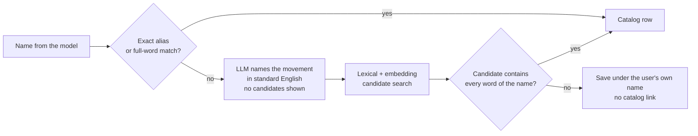
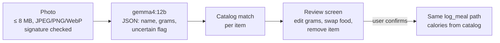

# AI design

PulseCoach's coach runs on a small open model (`gemma4:e4b`) on our own GPU. A small model is fast, cheap and private,
but it will sometimes call the wrong tool, skip a tool, or say it saved something it did not. Most of the work in this
part of the project went into making the system trustworthy around those failures: every number is computed by
code, every write is checked, and every important behavior is measured with the real model.

- [Models](#models)
- [Orchestrator and tools](#orchestrator-and-tools)
- [Guards after the model](#guards-after-the-model)
- [Safety: crisis layer and medical limits](#safety-crisis-layer-and-medical-limits)
- [Knowledge base and RAG](#knowledge-base-and-rag)
- [Matching free text to the catalogs](#matching-free-text-to-the-catalogs)
- [Meal photo pipeline](#meal-photo-pipeline)
- [Calorie and macro recommendation](#calorie-and-macro-recommendation)
- [Evaluations](#evaluations)
- [Serving the models](#serving-the-models)

## Models

| Model | Used for | Why |
|---|---|---|
| `gemma4:e4b` | Chat orchestrator, weekly reviews, reminders, exercise naming | Won a 248-call comparison against `qwen3:14b`: equal or better tool calling and safety, no RAG hallucinations, about 40% faster. Runs with `reasoning=True`: with thinking off, replies were much faster but the model called the needed tool in only 1 of 4 tries. |
| `gemma4:12b` | Meal photo analysis | `e4b` lists vision as a capability but did not process images in practice. Compared with `gemma3:4b` on real meal photos, `12b` recognized cooking state (fried vs. boiled) more reliably, which changes the calories. |
| `nomic-embed-text` | RAG and catalog search | Small, local, good enough for short Turkish and English texts. |

All three run in Ollama on the same server. Model names are settings (`LLM_MODEL_NAME`, `PHOTO_VISION_MODEL_NAME`,
`EMBEDDING_MODEL_NAME`), so a model can be swapped and re-evaluated without code changes. The measurements behind
each choice are in [MODEL-EVALUATION.md](MODEL-EVALUATION.md).

## Orchestrator and tools

There is one ReAct agent (`langchain.agents.create_agent`) per chat turn, with 21 tools. The tools are grouped into
domain modules, which the code calls "agents" because each started as a separate agent in the first design:

| Module | Tools |
|---|---|
| `profile_agent` | `get_user_profile`, `update_user_profile`, `get_calorie_recommendation` |
| `nutrition_agent`, `exercise_agent` | `search_nutrition_knowledge`, `search_exercise_knowledge` (RAG) |
| `nutrition_tracking_agent` | `search_food_catalog`, `log_meal`, `log_meals_bulk`, `get_daily_nutrition_summary` |
| `workout_tracking_agent` | `search_exercise_catalog`, `log_exercise_set`, `log_exercise_sets_bulk`, `get_workout_summary`, `set_exercise_goal`, `get_exercise_goals` |
| `tracking_agent` | `log_progress`, `get_weekly_summary` |
| `motivation_agent` | `generate_encouragement`, `generate_checkin_message` |
| `mood_support_agent` | `generate_supportive_response`, `log_mood` |

A single agent keeps each turn to one model loop: with a small model, every extra hand-off between agents would add
latency and another chance to lose information. In the model comparison, this design picked the right domain in 94%
of scenarios and called tools correctly in 100%.

**Tool rules** (they apply to every tool, because tool arguments come from the model):

- Accept `None` for every optional argument and keep numbers inside the bounds in `limits.py`. Values that would put
  data in the wrong place, such as an impossible day, are rejected with a clear message instead of silently adjusted,
  because a wrong record in a health log is worse than no record.
- Return plain text that tells the model exactly what happened, including partial failures
  (*"Saved 3 sets; 'cable fly' was saved without a catalog match"*).
- Tools are created per request and bound to the user and the database session. The model never sees or passes a
  user id.
- Past days are an explicit `days_ago` argument (yesterday = 1). Negative values (*"I'll run tomorrow"*) are not
  logged. A post-check fixes replies that call a record from two or more days ago "yesterday".
- Read-only knowledge tools return raw guidance, and the orchestrator phrases it in the user's language and tone.
  This keeps one voice across the app.

**The system prompt is rebuilt every turn.** It includes the safety rules, today's local date and a hint for
relative days, the user's language, coach tone and dietary restrictions, today's mood (and a gentle note if mood has
been low on 3 or more of the last 14 days), and a reply length directive. The length directive comes from a
classifier on the user's message: brief (*"in short"*), normal, or detailed (*"explain step by step"*).

**History** is the last 20 messages. A typical prompt, including tool schemas, is about 12k tokens (median 11.9k,
largest seen 16.1k), so the context is set to 32k. A logging callback warns when a prompt passes 80% of the context,
because Ollama silently cuts the beginning of a prompt that is too long, and the first thing to go is the system
prompt.

**No edit or delete tools, on purpose.** Letting a small model delete health records from a sentence like *"remove
that"* was judged too risky. When a message looks like a correction (*"I wrote it wrong"*, *"move it to
yesterday"*), the logging tools are replaced for that turn by stubs that save nothing and explain why. The coach then
points the user to the swipe-to-edit and swipe-to-delete actions on the relevant screen. Without this, a correction
became a second, duplicate record.

**The profile tool sees weight and height but not age or sex.** Those fields were collected for the calorie
recommendation, and KVKK's purpose limitation keeps them there.

## Guards after the model

`orchestrator._finalize` runs after the model's last message and compares the reply with what actually happened.

| Situation | Guard |
|---|---|
| The reply claims a save (*"I've logged it"*), but no write tool succeeded | Retry once with a note that nothing was saved. If it happens again, replace the reply with an honest *"I couldn't process this, nothing was saved."* The patterns are Turkish and English, and handle negation (*"I haven't saved it yet"*). |
| The reply claims an edit or delete, which the coach cannot do | Replace it with directions to the in-app edit. For goal changes, which do have a tool, retry once. |
| Empty reply after successful tool calls | Ask the model once more for a summary only. If that fails, use a fixed *"I saved this but couldn't summarize it"* message. |
| Some writes failed and others succeeded | Add a note listing what was not saved. |
| A suspicious value (for example a 600 kg squat) | Make sure the reply asks the user to confirm. |
| Sets were logged | Add a short, code-generated summary of what was written, so the user can check it. |
| Reply too long for the request | Cap at 4 sentences (brief), 12 (normal) or 80 (detailed). Sentence counting ignores list numbers and Markdown headings, so a list is never cut in the middle of an item. |
| A repeated tool call in the same turn | `TurnDedupGuard` stops a bulk call and a single call from writing the same set or meal twice, without blocking sets that really are identical. |

Each guard exists because of a failure seen in live testing or in the regression suite. The most serious: in about 1
in 4 runs, *"3 sets of 10 at 62.5 kg"* was logged as **one** set while the coach replied *"logged 3 sets"*. The model
was passing a `set_count` argument that the single-set tool did not have, and LangChain dropped it silently. Unit tests
could not catch this. Running the real model against a copy of the database and recording every tool call did, which
led to the regression suite below.

## Safety: crisis layer and medical limits

- **Crisis detection is deterministic.** `check_crisis_indicators` runs on the raw message before the model is called.
  It covers self-harm, suicidal thoughts, prolonged hopelessness and eating disorder signals, in Turkish and English,
  with and without Turkish characters, and tolerates filler words between key words. It is tuned for recall: a false
  alarm is acceptable, a miss is not. On a match, a fixed reply with emergency contacts is returned (112 in Turkey,
  988 in the United States), and the model's output is never used for that turn.
- **Mood never suppresses the crisis check.** A *"great"* mood logged that day does not stop a crisis message from
  triggering, and a low mood does not trigger the template by itself. Both are covered by regression tests.
- **Helpline numbers are verified at the source.** Many websites list 182 as a Turkish crisis line. The Ministry of
  Health's own page says it is the hospital appointment line. Only numbers confirmed by an official source are used.
- **Medical limits** in the system prompt: no diagnosis, no medication or treatment advice, no therapy. Concrete
  physical symptoms (unexplained weight loss, persistent pain) lead to a referral to a professional.
- **Low calorie floors.** The calorie recommendation never goes below 1,200 kcal (women) or 1,500 kcal (men), and the
  app is 18+.

The crisis layer has its own test file (`tests/test_mood_support.py`). Its bar is "never misses", not "works well".

## Knowledge base and RAG

`backend/knowledge_base/` holds 15 short articles: 7 on nutrition (energy needs, macronutrients, protein,
hydration, goal-based eating, meal ideas, Turkish dietary guidelines) and 8 on exercise (WHO activity guidelines for
adults and older adults, progressive overload, movement form, warm-up, sleep and recovery, reducing sitting, training
by goal). They are written in our own words from WHO, ISSN, NSCA, CDC and the Turkish Dietary Guidelines (TÜBER 2022),
not copied, and every article names its sources.

- Split with `RecursiveCharacterTextSplitter` (500 characters, 80 overlap), embedded with `nomic-embed-text`, stored
  in a `faiss-cpu` `IndexFlatL2` per category, and the top 4 chunks are retrieved.
- The index is stored as a FAISS file plus JSON documents. The earlier LangChain community store loaded a pickle from
  disk, so anyone who could write to that folder could run code. It was replaced and the results were checked to be
  identical on a fixed query set.
- Indexes are built at release time (`scripts.release`), so the first user does not wait and several API workers do
  not build them at the same time.

In the model comparison, groundedness to these sources was the main difference between models: `gemma4:e4b` scored
4.53/5 with no invented facts. `qwen3:14b` scored 4.06, invented a WHO sitting-time threshold and mixed up the Turkish
plate model with the U.S. MyPlate model.

## Matching free text to the catalogs

Users write *"halatla triceps"*, *"db rdl"* or *"stair climber"*. The catalog says *"Triceps Pushdown – Rope
Attachment"*, *"Romanian Deadlift"* and *"Stairmaster"*. A wrong match is worse than no match, because it silently
puts the user's sets on the wrong exercise.

1. **Lexical matching** (`fuzzy_match.py`) handles Turkish suffixes, `İ/ı`, missing Turkish characters, filler words,
   equipment words (*dumbbell / dambıl*) and hundreds of hand-checked aliases (`exercise_aliases.py`,
   `food_aliases.py`).
2. If that is not certain, the **model only names the movement** in standard English (temperature 0, no thinking, all
   unclear names in one call, about 1.5 seconds). An earlier version showed the model a candidate list. It picked
   similar but wrong candidates and even bent the name to fit them, so the candidates were removed.
3. **Code picks the row**, using word and embedding search over the catalog (`catalog_vectors.py`). If nothing contains
   every word of the English name, the set is saved without a catalog link rather than linked to the wrong exercise.

Measured on 230 labeled phrases (`eval/exercise_match_benchmark.py`): the easy set stayed at 40/40, and on the 190
harder phrases wrong matches fell from 49 to 21 and correct ones rose from 122 to 161.

The food catalog uses the same lexical layer. USDA names were translated to Turkish in bulk with `gemma4:12b`, and
then the most common foods were reviewed and corrected by hand.

## Meal photo pipeline

The vision model only names foods and estimates grams. It never produces calories. Each item is matched to the
catalog (or offered as a list of candidates), items the model is unsure about are flagged, and **nothing is saved
until the user confirms**. Saving goes through the same service as a typed meal, so calories and macros always come
from the catalog. Photos are kept for history within a count and age limit, and the user can delete them.

## Calorie and macro recommendation

This part is deliberately not AI. `calorie_recommendation_service.py` uses:

- Mifflin-St Jeor for resting energy, multiplied by standard FAO/WHO activity factors (1.2–1.725).
- Weight loss: −500 kcal, but never more than 20% below expenditure. Muscle gain: +250 kcal. Otherwise maintenance.
- Floors of 1,200 / 1,500 kcal.
- Protein per kg of body weight (1.2–1.8 g depending on goal and activity, capped at 35% of calories), fat at 25% of
  calories (at least 0.6 g/kg), carbs fill the rest.

The recommendation is only shown. It becomes a goal when the user accepts it. Calories and macros are linked both ways:
pin the calories and the macros rebalance, or change a macro and the calories follow. The same rule applies in the web
app, the iOS app and the chat.

Cardio calories use MET values from the Compendium of Physical Activities, the user's latest weight, duration and
intensity. If no weight has been logged, no estimate is shown instead of assuming a default weight. Strength sets get no calorie estimate, on purpose, because the available estimates are too rough to show
as a number.

## Evaluations

Everything in `backend/eval/` runs against the real model through Ollama. These are not unit tests (there are about
1,260 of those in `backend/tests/`, which run without a model).

| Script | What it measures |
|---|---|
| `chat_regression.py` | 47 real user sentences, each run N times (usually 5). Checks what was **written to the database** (sets, reps, kg, minutes, foods, grams, which day, mood, goals) and the tool calls, not just the reply. Runs on a temporary copy of the development database, with a fresh user per trial. Exits non-zero below 100%. Run after every agent, prompt or tool change. |
| `run_eval.py` + `scenarios.py` | The model comparison: 82 scenarios across tool calling, routing, RAG groundedness, safety boundaries, Turkish quality and latency. Manual 1–5 scores for quality, automatic pass/fail for the rest. [Report](../backend/eval/results/model_comparison.md). |
| `exercise_match_benchmark.py` | 230 labeled exercise phrases: correct / wrong / missed. |
| `reply_length_eval.py` | Whether brief, normal and detailed requests get the right length, and how often replies are cut. Moving the length rule into a per-turn directive cut brief replies from 16.7 s to 9.4 s and normal ones from 23 s to 14.5 s. |
| `latency_benchmark.py` | Time to first status, first text and full reply, at 1 to N concurrent users, with the app's real context size. |

Full method and results: [MODEL-EVALUATION.md](MODEL-EVALUATION.md). Two methodology lessons from the model
comparison:

- The first round showed both models with equal latency. The script alternated models, so Ollama reloaded a model
  into GPU memory on almost every call. Batching by model showed `e4b` was about 40% faster.
- In two rounds, each model missed one safety boundary case, and not the same case. That pointed to a gap in the
  prompt and routing design, not to a weaker model, and the prompt was fixed.

## Serving the models

On the production GPU (24 GB), Ollama runs with flash attention, a `q8_0` KV cache and 4 parallel slots. With those
settings a 32k context uses less memory than a 20k context in f16. Models are kept loaded indefinitely
(`keep_alive=-1m`), and a `warm-models` service reloads them after every Ollama restart, so the first user does not
wait about 20 seconds for a cold load. Every warm-up and benchmark request must use the app's exact `num_ctx`.
Otherwise Ollama reloads the model with the new size.

A daily per-user quota (100 messages, 20 photos) and short-window rate limits keep one user from occupying the GPU.
