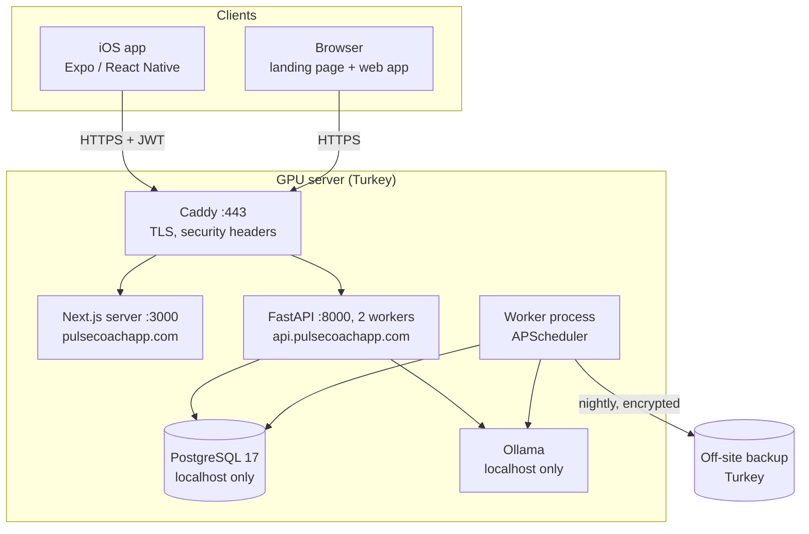
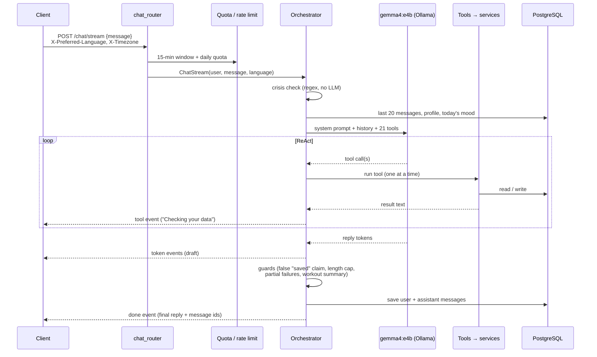
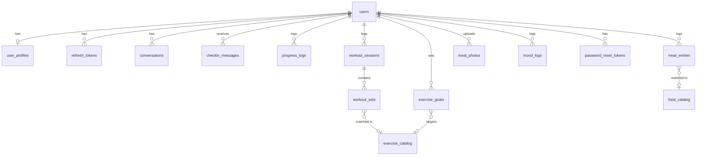

# Architecture

PulseCoach has one backend, two clients and one GPU server. This document explains how the parts fit together and why
they are built this way. For the AI side (agent, tools, RAG, evaluations) see [AI.md](AI.md).

- [System overview](#system-overview)
- [Backend layers](#backend-layers)
- [A chat turn, end to end](#a-chat-turn-end-to-end)
- [Chat streaming](#chat-streaming)
- [Data model](#data-model)
- [Time zones and language](#time-zones-and-language)
- [Scheduler and worker](#scheduler-and-worker)
- [Authentication and abuse limits](#authentication-and-abuse-limits)
- [Clients](#clients)
- [API contract between backend and clients](#api-contract-between-backend-and-clients)

## System overview



Everything runs on a single GPU virtual machine. Only Caddy listens on the internet (ports 80 and 443). PostgreSQL
and Ollama listen on `127.0.0.1` only. Each process is a systemd unit running as an unprivileged `pulsecoach` user that
cannot write to the code directory. Details are in [DEPLOYMENT.md](DEPLOYMENT.md).

A single machine is a deliberate choice for this stage. The expensive part is the GPU, the language model needs to be
close to the data, and one server keeps health data inside one jurisdiction. The code still separates the parts that
need to scale: the API is stateless (several Uvicorn workers), the scheduler runs as its own single process, and the
database is reached only through `DATABASE_URL`.

## Backend layers

```
backend/app/
  main.py            app setup, CORS, body size limit, health checks, error handlers
  auth/              register/login/OAuth, JWT, bcrypt, rate limiting
  routers/           thin HTTP layer (validation, status codes, language)
  chat_router.py     /chat, /chat/stream, history
  services/          business logic, the only layer that talks to models
  models/            SQLAlchemy 2 models (17 tables)
  schemas/           Pydantic request/response models
  agents/            orchestrator, tools per domain, prompts, crisis layer
  rag/               embedding, FAISS store, retriever
  scheduler/         job definitions and the scheduler
  worker.py          entry point for the separate scheduler process
```

The rule is simple: **routers, agent tools and scheduler jobs all call the same services.** Logging a meal by tapping
*Save*, by telling the coach *"I had two eggs"* or by confirming a meal photo ends up in the same
`nutrition_log_service` function, with the same validation and limits. The agent never writes to the database
directly. This removed a whole class of bugs where the chat path and the form path behaved differently.

Shared rules that every layer follows:

- **Validation errors** are raised as `AppValidationError(code)` and translated to Turkish or English in one place
  (`app/exceptions.py`).
- **Numeric limits** (weight, reps, grams, minutes…) live in `app/services/limits.py`. They apply to API input and
  to values the model passes to tools. An unbounded value once broke a user's workout summary permanently, so every
  number has an upper bound.
- **The user's "today"** always comes from `user_time.user_today()`, never from the server clock (see
  [Time zones](#time-zones-and-language)).

## A chat turn, end to end



1. **Crisis check first.** `check_crisis_indicators` scans the raw message with Turkish and English patterns before
   anything else. On a match the model is never called. A fixed reply with emergency numbers is returned (112 in
   Turkish, 988 in English). Only the fact that it triggered is logged, never the message.
2. **Context.** The orchestrator loads the last 20 messages, the profile (goals, dietary restrictions, coach tone),
   today's mood and a 14-day low-mood flag, and builds a system prompt for this turn. The prompt also states today's
   local date and a hint for words like *"yesterday"*.
3. **Agent.** A fresh `create_agent` instance gets 21 tools bound to this user and this database session. Tool calls
   run with `max_concurrency=1`. The session is not thread-safe, and parallel tool calls used to crash with
   *"session is in 'prepared' state"*.
4. **Guards.** After the model finishes, `_finalize` checks the reply against what actually happened (see
   [AI.md › Guards](AI.md#guards-after-the-model)).
5. **Persistence.** Both messages are stored in `conversations`. The client replaces its draft with the final text.

## Chat streaming

`POST /chat/stream` returns Server-Sent Events: `tool` (a tool is running, with a localized label), `token` (draft
text), `reset` (discard the draft so far) and `done` (the final reply, the agent that handled it, and message ids).

The streamed text is a **draft**. Some guards can only run on the complete reply. For example, the model may write
*"Saved!"* and only then turn out not to have called a tool. So the `done` event carries the authoritative text and
the client swaps it in (usually it is identical). While streaming, the same sentence cap is applied, and the draft
stops early if it claims a save that no successful write tool backs up.

Streaming is built on LangChain callbacks (`orchestrator.ChatStream`) and a queue drained by the response generator,
not on LangGraph's `stream_mode="messages"`. That mode deadlocks when combined with `max_concurrency=1`. Removing
`max_concurrency` would run tools in parallel on the shared session, which brings back the crash above. See
[ENGINEERING-NOTES.md](ENGINEERING-NOTES.md#3-streaming-without-deadlocks).

The web client reads the stream with `fetch`. The iOS client uses `expo/fetch`, because React Native's built-in fetch
does not expose a streaming body.

## Data model



| Table | Purpose |
|---|---|
| `users` | Account, Google/Apple identities, time zone, separate consent timestamps (KVKK, health data, terms) and consent version |
| `user_profiles` | Goal, activity level, dietary restrictions, height, birth year, sex, calorie and macro targets, weight/waist/body fat goals, weekly workout days goal, language, coach tone, notification preferences |
| `progress_logs` | Weight, waist, body fat, workout done/type, per local date |
| `workout_sessions`, `workout_sets` | A session per day and workout; a set holds **either** reps (+ weight) **or** duration (+ intensity, cardio category, MET-based calorie estimate) |
| `exercise_catalog` | 891 exercises (from free-exercise-db, translated to Turkish, with aliases) |
| `exercise_goals` | Target weight and reps for an exercise |
| `meal_entries` | Food, grams, meal type, calories and macros computed from the catalog at save time |
| `food_catalog` | 7,916 foods: USDA FoodData Central (SR Legacy, Foundation, FNDDS) translated to Turkish, plus Turkish dishes researched by hand |
| `meal_photos` | Analyzed meal photos (kept within a count and age limit) |
| `mood_logs` | One mood per user per day (`zor`, `dusuk`, `notr`, `iyi`, `harika`) |
| `conversations` | Chat history (user and assistant messages) |
| `checkin_messages` | Weekly reviews and reminders shown in the in-app notifications screen |
| `refresh_tokens`, `password_reset_tokens` | Stored as hashes only |
| `rate_limit_attempts` | Sliding-window rate limits and the daily chat/photo quota |

The schema is managed by Alembic (18 migrations). CI runs every migration from an empty PostgreSQL database and checks
that the result matches the SQLAlchemy models. Development uses SQLite. SQLite does not enforce foreign keys, so the
test suite also runs on PostgreSQL, where they are enforced.

Catalog data is not stored in git. A release script loads it from a snapshot on first install and then applies
versioned changes from the repository: new Turkish foods, name fixes, exercise renames.

## Time zones and language

Both clients send two headers with every request:

- `X-Timezone` (for example `Europe/Istanbul`), stored on the user. *"Today"*, streaks, weekly goals, the daily quota
  and scheduled jobs all use the user's local date. An early bug counted a 01:00 workout in Istanbul as the previous
  day.
- `X-Preferred-Language` (`tr` or `en`), the language currently on screen. Error messages, catalog names, generated
  summaries and the coach's reply follow it. The coach answers in the screen language even if the profile says
  otherwise, and fixed fallback messages are chosen from per-language dictionaries instead of trusting the model.

Turkish needs care in code. Python's `str.lower()` turns `"İ"` into `"i̇"` (an `i` plus a combining dot). That broke
matching at the start of sentences, including the most important crisis phrases. All case folding goes through
`tr_lower()`.

## Scheduler and worker

| Job | When | What |
|---|---|---|
| Weekly summary | Every hour | For users whose local time is Sunday 12:00: build last week's numbers, let the coach phrase them in the user's tone, store a check-in |
| Daily nudge | Every hour | For users at their chosen local hour: if mood or meals are not logged yet or a streak is at risk, one short combined message (with a cooldown of a few days; nothing is generated when everything is fine) |
| Database backup | Nightly | `pg_dump`, keep the last 14 locally, copy off-site through an encrypted rclone remote |
| Rate limit cleanup | Nightly | Delete old attempt rows |
| Photo retention | Nightly | Delete meal photos beyond the count/age limit |

In production the scheduler runs in its own process (`python -m app.worker`), and the API processes start with
`SCHEDULER_ENABLED=false`. As a safety net, the scheduler takes a PostgreSQL advisory lock, so even a misconfigured
second process cannot send duplicate messages. Migrations take a lock too.

The server does **not** send push notifications or emails for check-ins. The iOS app schedules its own local
notifications (Sunday evening for the weekly review, and an occasional reminder when the app has not been opened).
Their text is generic and never shows health data on the lock screen. When the user opens the app, the message is
already waiting in the notifications screen. Dropping server push also removed a transfer of data to a push provider
abroad (see [PRIVACY.md](PRIVACY.md)).

## Authentication and abuse limits

- **Passwords:** bcrypt (cost 12). Password reset always answers the same way, so it cannot be used to find out
  whether an email is registered.
- **Tokens:** a 30-minute access JWT with a `typ` claim, plus a 30-day opaque refresh token stored as a hash and
  rotated on every use. Logout revokes it. Clients delete stored tokens only on a 4xx refresh response, so a phone
  that opens offline does not log the user out.
- **Google and Apple sign-in:** the server verifies the ID token against the allowed client IDs. A first-time social
  user gets a short-lived *pending* token and must accept the KVKK consent before an account is created.
- **Rate limits** (15-minute windows): login per account and per IP, registration, password reset, chat and photo
  analysis.
- **Daily quota:** 100 chat messages and 20 photo analyses per user, reset at the user's local midnight. The
  15-minute window only stops bursts. The daily quota keeps one user from filling the shared GPU.
- **Request limits:** a 12 MB body limit, an 8 MB photo limit with a file signature check, length limits on every
  text field.
- **Web:** strict security headers (CSP with `frame-ancestors 'none'`, HSTS through Caddy).
  **iOS:** tokens in the Keychain (SecureStore), optional Face ID lock, jailbreak detection.

## Clients

Both clients mirror the same API wrapper (`web/src/lib/api.ts`, `mobile/lib/api.ts`) and share a design language:
glass cards, a color identity per tab (for example olive for nutrition, red for workouts, amethyst for profile, and
one fixed color per metric on the progress tab) and the same order on every screen (metrics → goals → coach
insight → form).

**Web (`web/`)**: Next.js 16 with the App Router. The root `/` is the landing page (TR/EN, light and dark screenshots
of the real app), next to the legal pages, a sitemap and `robots.txt` for search engines. The signed-in app lives under the `(app)` route
group and is client-rendered. Charts are custom SVG components shared in spirit with the mobile ones, with Recharts in
a single place. Playwright end-to-end tests cover auth, chat (with the real model), goals, progress, workouts and
security headers.

**iOS (`mobile/`)**: Expo SDK 54 with Expo Router. There are five tabs: Chat, Progress, Workouts, Nutrition, Profile.
Expo Router tabs never unmount, so screens refresh with a debounced focus effect instead of a mount-only effect. Rapid
tab switching once caused visible stutter. It was profiled and fixed with a shared animation clock and debounced
loading ([ENGINEERING-NOTES.md](ENGINEERING-NOTES.md#9-mobile-performance-measure-first)). Native modules are imported
dynamically, so a JavaScript update can never crash an older installed build.

## API contract between backend and clients

The backend exports its OpenAPI schema (`python -m scripts.export_openapi openapi.json`). `npm run gen:api` in `web/`
and `mobile/` turns it into TypeScript types. A small `api-contract.ts` file in each client compares those generated
types with the hand-written ones in `api.ts`. If a field is renamed or its type changes in the backend, `tsc` fails.
CI regenerates the schema and fails if the committed copy is stale. The first run of this check found two real
mismatches that had gone unnoticed.
