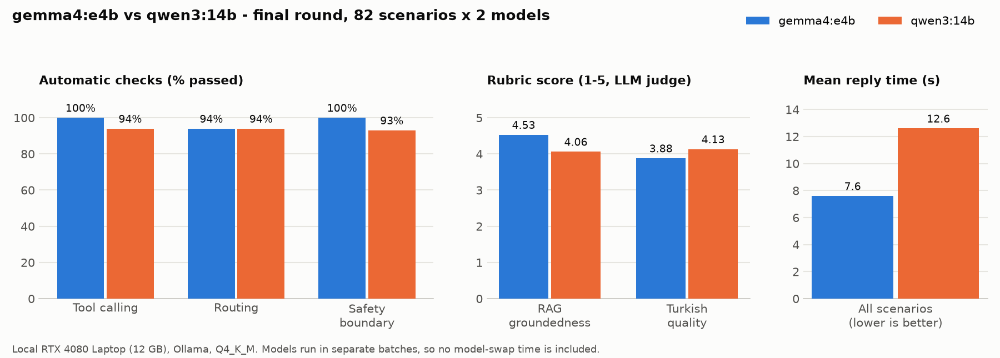

# Model evaluation

Every model choice in PulseCoach was made by measurement. This document collects those measurements: how the chat model
was chosen, why thinking stays on, why the photo model differs from the chat model, how exercise matching was tuned,
and how the models are served. The scripts live in [`backend/eval/`](../backend/eval/). The detailed Turkish report of
the main comparison, with all charts and raw results, is
[`backend/eval/results/model_comparison.md`](../backend/eval/results/model_comparison.md).

- [Method](#method)
- [Chat model: gemma4:e4b vs qwen3:14b](#chat-model-gemma4e4b-vs-qwen314b)
- [Thinking on or off](#thinking-on-or-off)
- [A bigger chat model: gemma4:12b](#a-bigger-chat-model-gemma412b)
- [Photo model: gemma3:4b vs gemma4:12b](#photo-model-gemma34b-vs-gemma412b)
- [Exercise name matching](#exercise-name-matching)
- [Reply length](#reply-length)
- [Serving: concurrency and model versions](#serving-concurrency-and-model-versions)
- [Limitations](#limitations)
- [Reproducing](#reproducing)

## Method

The evaluations treat the model like any other learned component: a fixed, labeled test set, metrics chosen before
looking at results, and care to avoid fooling ourselves.

| Practice | How it is applied |
|---|---|
| **Labeled scenario sets per capability** | Each scenario states the expected tool, routing target or safe behavior. Categories: tool calling, routing, safety boundary, RAG groundedness, Turkish quality. |
| **Automatic metrics where possible** | Tool calls, routing and safety are pass/fail from the agent's actual tool calls and output, not from reading the reply. |
| **Rubric scoring with an LLM judge** where it is not | Groundedness to the knowledge base and Turkish language quality were scored 1–5 against a written rubric by Claude, with the source text in view. Every score is stored with a one-line reason in `eval/apply_manual_scores.py`. |
| **Negative controls** | Messages that must **not** trigger a tool (*"who are you?"*, a goodbye) catch a model that calls tools too eagerly. |
| **Ground truth from the database** | The chat regression suite checks what was written (sets, reps, kg, grams, which day), not what the reply claims. |
| **Repeated trials** | Model output is random, so each chat regression scenario runs N times (usually 5). A scenario passes only at 100%. |
| **Independent rounds** | The model comparison was run twice with different scenario sets. Findings that held in both rounds were trusted, findings that flipped were investigated. |
| **Controlling confounders** | Models are run in separate batches, so GPU model-swap time does not leak into latency. Benchmarks use the app's exact context size. |
| **Held-out data** | The exercise matcher was tuned on some labeled sets and checked on a set that no rule was written for. |
| **Isolation** | Every run uses an in-memory or temporary copy of the database and a fresh user. Production data is never touched. |

## Chat model: gemma4:e4b vs qwen3:14b

<p align="center"></p>

Both models ran locally through Ollama (RTX 4080 Laptop, 12 GB, Q4_K_M quantization, thinking on). In raw generation
speed `gemma4:e4b` produced about 86 tokens/s and `qwen3:14b` about 42.

| Metric | Round 1 e4b | Round 1 qwen3 | Final e4b | Final qwen3 |
|---|---|---|---|---|
| Scenarios × models | 42 × 2 | | 82 × 2 | |
| Tool calling (pass) | 100% | 100% | **100%** | 94% |
| Routing (pass) | 100% | 100% | 94% | 94% |
| Safety boundary, model-handled cases (pass) | 83% | **100%** | **100%** | 93% |
| RAG groundedness (1–5) | **4.50** | 3.88 | **4.53** | 4.06 |
| Turkish quality (1–5) | 4.00 | **4.38** | 3.88 | **4.13** |
| Mean reply time | 24.2 s ⚠ | 25.0 s ⚠ | **7.6 s** | 12.6 s |
| Emoji per reply | 0.90 | 0.38 | 0.88 | 0.15 |

⚠ Round 1 latency is not valid: the script alternated models, so Ollama reloaded a model on almost every call. The
final round batched by model.

**What the two rounds showed**

- **Consistent in both rounds:** `e4b` was more faithful to the knowledge base, and `qwen3` wrote slightly better Turkish.
- **Hallucinations:** across 25 RAG scenarios, `e4b` invented nothing. `qwen3` invented a WHO sitting-time threshold the
  source explicitly says does not exist, and described the Turkish plate model with U.S. MyPlate percentages.
- **Skipped tools:** `qwen3` repeatedly answered knowledge questions without calling the knowledge tool, in five different
  scenarios across both rounds, even though the prompt requires it.
- **A repeatable language error:** in both rounds `qwen3` began an empathetic reply with *"Anlamıyorum"* ("I don't
  understand") where *"Anlıyorum"* ("I understand") was meant.
- **`e4b`'s weakness** was length: it often ignored the "3–4 sentences" rule. That is an engineering problem, later
  solved with a per-turn length directive and a sentence cap (see [Reply length](#reply-length)).
- **The safety case that flipped:** one scenario (unexplained weight loss) was missed by `e4b` in round 1 and by `qwen3`
  in round 2. Both misses happened when the message was routed to the mood-support tool, whose guidance said "support,
  don't diagnose". It was a prompt design gap, not a model difference, and the guidance now sends concrete physical
  symptoms to a professional regardless of the model.

**Decision:** `gemma4:e4b`. In a health app, faithfulness to sources matters more than style. It was also about 40%
faster, and its main weakness could be fixed in code. Round 1 alone pointed the other way. The second, larger round
reversed the decision, which is why it was run.

## Thinking on or off

`gemma4:e4b` is a thinking model. Turning thinking off made replies dramatically faster (about 1.5 s), but the model then
called the needed tool in only **1 of 4** tries: it chatted instead of logging. Since logging is the core of the app,
thinking stays on. The bounded sub-tasks that do not need it (naming an exercise, translating the catalog, analyzing a
photo) run with thinking off.

## A bigger chat model: gemma4:12b

Before renting the production GPU, the larger `gemma4:12b` was tested as the chat model with the chat regression suite
on the same laptop:

| | gemma4:e4b | gemma4:12b |
|---|---|---|
| Errors | 4 in 205 turns (30/30 on the six scenarios compared) | 4 in 26 turns |
| Median turn time | 7.8 s | about 28 s (one scenario took 208 s) |

The run was stopped early. The prompts and tools had been tuned on `e4b`, which may explain some of the `12b` errors, but
a 3–6× slower turn ruled it out for chat. `12b` is used only for meal photos.

## Photo model: gemma3:4b vs gemma4:12b

`gemma4:e4b` lists vision support but did not process images in practice, so a separate model is needed. Three real meal
photos were analyzed by both candidates:

| | gemma3:4b | gemma4:12b |
|---|---|---|
| Recognition errors (3 photos) | 6 | about 2.5 |
| Typical mistakes | missed microgreens and honey, asparagus as "broccoli stalks", blueberries as raspberries, **baked sweet potato as boiled** | fewer, smaller |
| Time per photo (model loaded) | about 5.9 s | about 6.5 s |

The cooking-state error matters because it changes the calories. `gemma4:12b` was chosen. On the 12 GB development GPU
the two models could not stay loaded together. The 24 GB production GPU keeps all three models loaded.

## Exercise name matching

230 realistic exercise phrases (Turkish and English mixed, typos, gym slang) were labeled by hand with the acceptable
catalog rows, or "no match" where the catalog has none. A wrong match is the worst outcome, because it silently files
the user's sets under another exercise. Results are correct / **wrong** / missed:

| Set | Before (word matching only) | After (model names + code matches) |
|---|---|---|
| Easy (40) | 40 / 0 / 0 | 40 / 0 / 0 |
| Hard (40) | 23 / 15 / 2 | 32 / 6 / 2 |
| Control (50) | 26 / 21 / 3 | 41 / 7 / 2 |
| Control 2 (50) | 34 / 9 / 7 | 45 / 4 / 1 |
| Control 3 (50, held out) | 39 / 4 / 7 | 43 / 4 / 3 |

Control and Control 2 were unbiased when first run, and some rules were then added after looking at their errors.
No rule was written for Control 3. Only the threshold that decides when to trust a word match was chosen by looking at
its distribution. On the held-out set, accuracy still improved, with no increase in wrong matches. The model is called
only for unclear names (about 1.2–2 s for a group of four), and never for exact or full-word matches.

How the matcher works: [AI.md](AI.md#matching-free-text-to-the-catalogs).

## Reply length

`reply_length_eval.py` sends brief, normal and detailed requests and measures length, time and how often the reply had
to be cut. Moving the length rule from the general system prompt into a short directive at the end of each turn's
prompt changed:

| | Before | After |
|---|---|---|
| Brief request, mean time | 16.7 s | 9.4 s |
| Normal request, mean time | 23 s | 14.5 s |
| Replies cut by the sentence cap | 6 of 9 | 2 of 18 |

## Serving: concurrency and model versions

**Parallel slots.** With four simultaneous users on `e4b` (5 runs each), Ollama with one slot vs four slots:

| | 1 slot | 4 slots |
|---|---|---|
| Median wall time | 35.1 s | 26.2 s |
| Median time per turn | 29.6 s | 18.0 s |
| Median time to first text | 27.0 s | 15.9 s |

The ranges did not overlap, and waiting fell by about 40%. With one or two users there was no difference. Production
runs with four slots.

**On the production GPU (RTX 4090 D),** four concurrent turns finished in about 13 s of wall time against about 18 s
one after another, a 1.4× gain. The variation between turns comes mostly from how much tool work and thinking each
message needs. A suspicion that speculative decoding hurt concurrency did not survive a repeated measurement.

**Model versions.** Ollama tags are mutable, and the `gemma4` tags were republished in October 2026. The old and new
versions were benchmarked side by side on the production server before switching. In two runs the new version was equal
or faster (single turn 4.5–4.6 s vs 5.0–6.2 s, median with four concurrent users 9.2–11.4 s vs 10.8–18.4 s), so
production moved to it, with the old models kept under separate names for rollback.

**Not adopted: vLLM.** It would improve throughput under heavy concurrent load (continuous batching, paged attention,
prefix caching). It would not change single-user latency, which comes from thinking tokens and several model calls per
turn. At the current scale, Ollama with four slots and a daily quota is simpler to operate.

## Limitations

- The rubric scores come from a single LLM judge (Claude). They were used to compare two models under the same rubric,
  not as absolute quality numbers.
- Scenario counts are small (tens per category), so differences of one scenario (94% vs 100%) are not significant by
  themselves. Decisions rested on patterns that repeated across rounds.
- Most measurements ran on a 12 GB laptop GPU. Production numbers are faster, and the relative results held.
- Prompts and tools were developed with `gemma4:e4b`, which favors it against any newcomer. That is acceptable for
  choosing a production model, but it should be remembered when re-evaluating.

## Reproducing

From `backend/`, with `ollama serve` running and the models pulled:

```bash
python -m eval.run_eval                         # model comparison (scenarios.py), raw results to eval/results/
python -m eval.apply_manual_scores              # merge rubric scores into the raw results
python -m eval.generate_charts                  # charts in eval/results/charts/
python -m eval.chat_regression --trials 5 --model gemma4:12b   # chat regression with another model
python -m eval.exercise_match_benchmark
python -m eval.reply_length_eval
python -m eval.latency_benchmark
```
